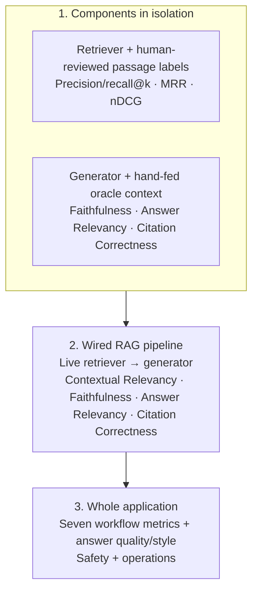

# Business AgentOS — Agent Eval and RAG Evaluation Report

**Report date:** 2026-11-13
**Project:** `D:\thon`
**Benchmark split:** Development only
**Business data:** Synthetic Cedar & Stone demo data
**Held-out evaluation:** Not run

The seven-metric workflow set is dataset v1.0.2 (8 scenarios). The general component golden set is now v0.6.3 (111 development cases plus 8 held-out cases); retrieval uses its 8 development RAG cases, and the output-guard run used 20 development cases. The 8-case component toxicity controls are a separate small fixture set. The holdout was not run or edited.

## Executive summary

This report combines the seven-metric agent-evaluation history with the new layered RAG evaluation.

- The first seven-metric run used benchmark dataset **v1.0.0**. It scored between **0.7709** and **1.0000** by metric, passed 7/8 workflows, and held review analysis because the RAG database was unreachable.
- The later seven-metric run used **v1.0.2**. All eight development workflows passed and all 52 applicable metric-case checks scored **1.0000**. The current 2026-11-13 app run on v1.0.2 produced the same seven scores and passed the four linked answer-quality judge cases.
- The v1.0.0 and v1.0.2 scores are **not a clean apples-to-apples before/after comparison**. Product behavior improved, and the metric contract/dataset was also corrected between versions.
- The latest RAG improvement cycle raised source macro precision from **0.633 to 0.833** and source F1 from **0.763 to 0.875** on the same eight queries and source labels. Pipeline Contextual Relevancy rose from **0.135 on three scored cases (one judge error)** to **0.650 on all four**. On the three answerable questions it averaged **0.867**; the deliberately unanswerable gross-margin control still scores 0.000 for context relevance while the agent abstains correctly.
- Exact passage labels were expanded from **2 to 7 queries**, then manually reviewed against the focused passages. Latest passage precision@5 is **0.343**, recall@5 **0.786**, MRR **0.929**, and nDCG **0.801**. This new passage score is not a direct before/after comparison because the judged-label coverage changed.
- These are small, synthetic development regressions, not a production accuracy estimate. The 1.0000 scores mean these particular checks passed; they do not mean the application is 100% reliable.

## 1. What the seven Agent Eval metrics mean

The workflow runner exercises the app path, records local traces, and the scorer applies each metric independently. A case can be applicable to some metrics and not others; the report shows the denominator for every score.

| Metric | What it checks | Where it is implemented |
|---|---|---|
| **Task completion** | Expected workflow outcome, answer presence, required content, evidence types, and citations. | Workflow trace collected by `run_workflow_smoke.py`; scoring in `agent_metric_eval.py`. |
| **Step efficiency** | Model/tool/workflow step counts, failed/duplicate calls, planner repairs, budgets, and wall time. Identical tool calls are considered duplicates only within the same workflow phase. | Trace events plus the step-efficiency scorer in `agent_metric_eval.py`. |
| **Argument correctness** | SQL/data-source and read-only verification contracts, expected query patterns, retrieval arguments, and permitted sources. | Recorded tool arguments/results plus dataset argument contracts. |
| **Tool correctness** | Expected versus actual specialists, tools, and read tables. | Workflow trace compared with each case's tool specification. |
| **Plan adherence** | Approval state/order, dependencies, task sequence, and whether evidence is used only after approval. | Recorded plans/tasks/evidence compared with the case's plan contract. |
| **Plan quality** | Plan schema, objective coverage, selected agents/sources, and task minimality. | Planner output compared with case-level expectations and aliases. |
| **Answer correctness** | Required numeric facts/content, forbidden claims, nonempty answer, and citation resolution. | Final workflow answer/evidence compared with the answer contract and linked gold case. |

The first six evaluate workflow execution and agent mechanics. Answer correctness checks the delivered response with deterministic assertions. A separate optional gold-linked judge reviews relevance, coverage, evidence support, and caveats; it is supplementary and does not replace human-checked references.

## 2. Seven-metric score progression

| Metric | First run: v1.0.0 | Later run: v1.0.2 | Latest app run: v1.0.2 | Applicable cases in final run |
|---|---:|---:|---:|---:|
| Task completion | 0.9236 | 1.0000 | 1.0000 | 8 |
| Step efficiency | 0.9299 | 1.0000 | 1.0000 | 8 |
| Argument correctness | 0.9896 | 1.0000 | 1.0000 | 8 |
| Tool correctness | 0.7709 | 1.0000 | 1.0000 | 8 |
| Plan adherence | 1.0000 | 1.0000 | 1.0000 | 7 |
| Plan quality | 0.9200 | 1.0000 | 1.0000 | 5 |
| Answer correctness | 0.8812 | 1.0000 | 1.0000 | 8 |

### What the first run found

The v1.0.0 run scored 8 scenarios and 52 applicable metric-case checks. Seven workflows passed; `review_analysis` was held because the local RAG database timed out. The other gaps were:

- **Forecast:** missing January/February/March and uncertainty markers, a `2025` argument-pattern check, and one requested plan-date marker.
- **Customer:** the report omitted the exact `six-month` answer marker.
- **Review analysis:** the RAG dependency failure prevented evidence-backed findings; the evaluator also expected stricter source selection and answer markers.
- **Tool correctness:** the 0.7709 mean was lowered by the review-analysis hold and tool-contract mismatches.

### What changed before the v1.0.2 run

**Product behavior changes** addressed actual output and workflow issues:

- Forecast wording now spells out full month names and explicitly labels the empirical 80% uncertainty interval.
- Review analysis is routed as one Customer Analyst task, retrieves passages, quotes cited excerpts, and labels positive/negative rating groups as proxies rather than treating ratings as sentiment labels or population prevalence.
- The RAG database was healthy for the final run, allowing the review-analysis path to complete with five retrieved passages.

**Evaluator and benchmark-contract corrections** changed how legitimate behavior is scored:

- The date-coverage check is recognized as a valid workflow tool.
- Equivalent ISO-date/month-name forms are accepted in plan checks.
- `products` is accepted as a legitimate source when category-scoped review retrieval needs product-category filtering.
- Repeated identical tool calls are penalized only when repeated within the same phase; approval rechecks and independent verification calls are not counted as duplicate work.

Because the dataset moved from v1.0.0 to v1.0.2, score gains combine product fixes with rubric corrections. Compare future runs against v1.0.2 unless the benchmark is explicitly re-versioned.

## 3. RAG evaluation design

The evaluation separates component behavior from the complete product path:

**Reference-based vs reference-free:**

- Retriever precision/recall, hit@k, MRR, and nDCG require human-reviewed relevant source/passages for each query.
- Isolated-generator Faithfulness, Answer Relevancy, and Citation Correctness receive the question, the generated response, and fixed oracle context. They do not receive an expected answer.
- Pipeline Contextual Relevancy, Faithfulness, Answer Relevancy, and Citation Correctness use the actual retrieved context. Exact passage coverage is separately compared with oracle passage references.
- Application answer correctness/completeness can compare output with reviewed gold facts. Style is judge-scored without a gold answer. Safety checks combine labeled injection/privacy/toxicity examples and output-guard decisions. Operations are measured from run traces.

DeepEval defines Faithfulness against `retrieval_context`, Answer Relevancy against the question/answer pair, and Contextual Relevancy as the retriever's signal-to-noise against the query. [Faithfulness](https://deepeval.com/docs/metrics-faithfulness), [Answer Relevancy](https://deepeval.com/docs/metrics-answer-relevancy), [Contextual Relevancy](https://deepeval.com/docs/metrics-contextual-relevancy)

## 4. RAG results

### 4.1 Retriever alone

The retrieval runner queried the live pgvector/FTS index on 8 development cases, with top-k = 5.

| Measure | Result | Denominator |
|---|---:|---:|
| Measure | Initial run | Latest improvement run | Cases / notes |
|---|---:|---:|---|
| Source precision | 0.633 | **0.833** | 8; same query/source labels |
| Source recall | 1.000 | 0.938 | 8; latest missed data-dictionary source on delivery-eligibility query |
| Source F1 | 0.763 | **0.875** | 8; same query/source labels |
| Exact source-set match | 0.125 | **0.625** | 8 |
| Passage precision@5 | 0.200 | 0.343 | Latest uses 7 passage-labeled queries; initial used 2, so not directly comparable |
| Passage precision among returned | — | 0.810 | 7 passage-labeled queries; facet retrieval may return fewer than five passages |
| Passage recall@5 | 0.750 | 0.786 | Latest uses 7 passage-labeled queries; initial used 2 |
| Passage hit@5 | 1.000 | 1.000 | 7 passage-labeled queries |
| MRR@5 | 0.750 | **0.929** | Latest uses 7 passage-labeled queries |
| nDCG@5 | 0.693 | **0.801** | Latest uses 7 passage-labeled queries |

The overall retrieval source balance improved, with one source-recall regression: `rag_v050_04` did not return `data_dictionary.md`; two extra sources were returned on that query. The remaining review-topic case has topical precision 1.000 and recall 0.600. This small lexical-tag coverage check is not a sentiment-accuracy benchmark.

### 4.2 Generator alone

Four questions were answered using hand-fed oracle passages. The harness forbids retrieval in this stage. No gold answer was sent to the judges.

| Case | Faithfulness | Answer Relevancy | Citation Correctness | Note |
|---|---:|---:|---:|---|
| `kpi_repeat_definition` | 1.000 | 1.000 | 0.900 | Source defines repeat customer but does not define lifetime returning status; the response now says so. |
| `kpi_net_product_sales_definition` | 0.800 | 1.000 | 1.000 | Supported definition and exclusions; Faithfulness judge gave a small deduction. |
| `company_reporting_context` | 1.000 | 1.000 | 1.000 | Currency, UTC, and date coverage cited to supplied context. |
| `gross_margin_abstention` | 1.000 | 1.000 | 1.000 | Explicit cited abstention; deterministic no-invented-percentage check passed. |
| **Mean** | **0.950** | **1.000** | **0.975** | 4 cases |

### 4.3 Wired RAG pipeline

The same four questions went through live retrieval, then the generator received the passages the index actually returned.

| Case | Contextual Relevancy | Faithfulness | Answer Relevancy | Citation Correctness | Exact passage recall@5 |
|---|---:|---:|---:|---:|---:|
| `kpi_repeat_definition` | **1.000** (was judge error) | **1.000** (was 0.750) | 1.000 | **1.000** | 1.000 |
| `kpi_net_product_sales_definition` | **1.000** (was 0.217) | 1.000 | 1.000 | 1.000 | 1.000 |
| `company_reporting_context` | **0.600** (was 0.188) | 1.000 | 1.000 | 1.000 | 0.500 |
| `gross_margin_abstention` | 0.000 | 1.000 | 1.000 | 1.000 | 1.000 |
| **Mean** | **0.650** | **1.000** | **1.000** | **1.000** | **0.875** |
| **Scored cases** | **4/4** | **4/4** | **4/4** | **4/4** | **4/4** |

Across the pipeline's four passage-reference diagnostics, precision@5 is **0.250**, recall@5 **0.875**, MRR@5 **1.000**, and nDCG@5 **0.909**. The deliberate gross-margin abstention case retrieves only the company overview; its Contextual Relevancy remains 0 because that overview does not provide the requested metric. Its evidence-sufficiency/abstention check passed, so the 0 should be read as “question not answerable from this evidence,” not a fabricated answer. On the three answerable questions, Contextual Relevancy is **0.867**.

**Observed remaining retrieval noise:** the reporting-context query still scores 0.600 because the data-dictionary overview contains incidental metadata, and its exact gold passage recall is 0.500. The delivery-eligibility retrieval query misses the data-dictionary source and needs a better query/candidate recall. The review-topic taxonomy remains at recall 0.600. No judge-format errors occurred in the latest pipeline run.

### 4.4 Whole application

The current full application run used the 8 development workflow cases and simulated the approval click in AppTest.

| Measure | Result | Cases |
|---|---:|---:|
| Task completion | 1.000 | 8 |
| Step efficiency | 1.000 | 8 |
| Argument correctness | 1.000 | 8 |
| Tool correctness | 1.000 | 8 |
| Plan adherence | 1.000 | 7 applicable |
| Plan quality | 1.000 | 5 applicable |
| Answer correctness | 1.000 | 8 |
| Linked gold-answer judge pass rate | 4/4 | 4 |
| Style G-Eval mean | 0.750 | 8 responses |
| Style G-Eval, business-report subset | 0.860 | 5 reports |

The all-response style mean includes a scope refusal to a greeting (0.10), an injection refusal (0.90), and an unsupported-period answer (0.70). The unsupported-period response contains confusing filler; style is kept separate from factual correctness.

**Safety:** Jev blocked the injection workflow before planning. Output guard matched 20/20 development labels (TP=12, FP=0, FN=0, TN=8). Toxicity judge matched 8/8 controls (4 safe, 4 toxic) and rated all 5/5 verified business reports non-toxic.

**Operations:** mean wall time **31.8 seconds**, with 14 model calls and 20 tool calls across the 8 workflows. Token counts and dollar cost are not currently recorded.

## 5. What to improve next

1. **Improve discovery for delivery eligibility.** `rag_v050_04` still misses the data-dictionary source. Improve candidate recall for eligible-shipment questions and add reviewed paraphrases/counterexamples.
2. **Split multi-sentence overview prose when its sentences answer distinct facts.** The reporting-context answer is complete, but its Contextual Relevancy is 0.600 because the dictionary overview includes incidental metadata.
3. **Expand and balance human-reviewed retrieval labels.** Seven of eight development queries now have passage labels. Review whether all helpful passages are annotated and add hard negatives. Keep holdout separate until the retrieval policy is frozen.
4. **Track answerability separately.** Keep the intentionally unanswerable gross-margin case as an abstention control. Report evidence sufficiency separately from Contextual Relevancy.
5. **Compare top-k settings and reranking after label coverage is broader.** A cross-encoder can improve ordering at additional compute/latency cost. [Sentence Transformers retrieve-and-rerank](https://sbert.net/docs/cross_encoder/usage/usage.html)
6. **Instrument usage.** Record model token usage and estimated dollar cost alongside latency and tool/model calls.

Focused chunking, conservative source-type routing, clause-aware passage selection, and reindexing are implemented in `rag.py`. The generator was not modified in this cycle. The full eight-case app benchmark was not repeated; the targeted `review_analysis` application workflow was rerun and passed all seven Agent Eval metrics on that single case, with five retrieved passages, verified citations, and output-guard approval.

## 6. Reproduction and artifacts

Run the copy/paste sequence in [RAG_EVALUATION_STRATEGY.md](RAG_EVALUATION_STRATEGY.md) from PowerShell in `D:\thon`. It uses `.eval-venv`, the local `.env`, and the running Docker RAG database; embedding, generation, and judge requests can incur API usage.

Key artifacts from the latest cycle:

- Earlier seven-metric report, v1.0.0: `agent_metric_report_20261112T171811Z.md`
- Later seven-metric report, v1.0.2: `agent_metric_report_20261112T175204Z.md`
- Current seven-metric full-app trace: `predictions_agent_metrics_ragapp_evalcycle_20261113.jsonl`
- Current seven-metric scorecard plus linked judge: `results_agent_metrics_ragapp_evalcycle_20261113_judged_v2.json`
- Latest retriever predictions/scorecard: `predictions_rag_retriever_final4_20261113.jsonl`, `results_rag_retriever_final4_20261113.json`
- Latest isolated generator predictions/scorecard: `predictions_rag_generator_focused_20261113.jsonl`, `results_rag_generator_focused_20261113.json`
- Latest pipeline predictions/scorecard: `predictions_rag_pipeline_final_20261113.jsonl`, `results_rag_pipeline_final_20261113.json`
- Targeted whole-app post-change review workflow: `predictions_agent_metric_review_analysis_rag_improvement_20261113.jsonl` (one scenario; all seven metrics scored 1.000)
- RAG component/pipeline results and cases: [RAG_EVALUATION_REPORT_20261113.md](RAG_EVALUATION_REPORT_20261113.md)
- Style scorecard: `results_app_style_evalcycle_20261113.json`
- Output guard scorecard: `results_output_guard_ragapp_evalcycle_20261113.json`
- Toxicity scorecard: `results_toxicity_ragapp_evalcycle_20261113.json`
