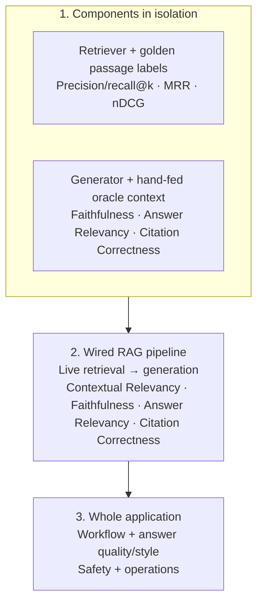

# Layered RAG and application evaluation

**Run:** 2026-11-13 development evaluation
**Project:** Business AgentOS (`D:\thon`)
**Data:** Synthetic Cedar & Stone demo data
**Holdout:** Not run

**Latest retrieval improvement run:** `rag.py` was updated with focused Markdown/JSON chunks, conservative source-type routing, lexical query-term tie-breaking, and clause-aware evidence selection. The index was re-embedded. The retrieval benchmark remains eight development cases; five additional passage-label sets were reviewed and added (two → seven labeled queries). The eight held-out cases were not used or edited.

For the historical seven-metric scores and the explanation of the v1.0.0 → v1.0.2 progression, see [AGENT_EVAL_AND_RAG_REPORT_20261113.md](AGENT_EVAL_AND_RAG_REPORT_20261113.md).

## Evaluation design

Retriever precision/recall use reviewed relevance labels. Generator and pipeline judge scores are reference-free: their DeepEval cases receive the question, generated answer, and the appropriate supplied/retrieved context, with no `expected_output`. Faithfulness compares answer claims to context; Answer Relevancy compares the answer to the question; Contextual Relevancy compares retrieved context to the question. [DeepEval Faithfulness](https://deepeval.com/docs/metrics-faithfulness), [Answer Relevancy](https://deepeval.com/docs/metrics-answer-relevancy), [Contextual Relevancy](https://deepeval.com/docs/metrics-contextual-relevancy)

## Latest improvement-cycle results

The source labels and eight queries are unchanged from the initial run, so source-level metrics are comparable. Passage metrics use the expanded, human-reviewed labels and should not be compared directly with the two-query baseline.

| Retriever measure | Initial | Latest | Evaluation scope |
|---|---:|---:|---|
| Source precision | 0.633 | **0.833** | 8 queries |
| Source recall | 1.000 | 0.938 | 8 queries |
| Source F1 | 0.763 | **0.875** | 8 queries |
| Exact source-set match | 0.125 | **0.625** | 8 queries |
| Passage precision@5 | 0.200 | 0.343 | Initial 2 labels; latest 7 labels |
| Precision among passages actually returned | — | 0.810 | 7 passage-labeled queries |
| Passage recall@5 | 0.750 | 0.786 | Initial 2 labels; latest 7 labels |
| Hit@5 | 1.000 | 1.000 | 7 passage-labeled queries |
| MRR@5 | 0.750 | **0.929** | Initial 2 labels; latest 7 labels |
| nDCG@5 | 0.693 | **0.801** | Initial 2 labels; latest 7 labels |
| Review topic P/R | 1.000 / 0.600 | 1.000 / 0.600 | 1 topical review query; lexical tags only |

One source-recall miss remains: `rag_v050_04` did not return the expected `data_dictionary.md` source. Net-sales and paid-search queries also returned one extra source each. Case-level breakdown is in the retriever scorecard.

| Live pipeline judge | Initial run | Latest run | Latest cases |
|---|---:|---:|---|
| Contextual Relevancy | 0.135 (3/4 scored; 1 judge error) | **0.650 (4/4)** | repeat 1.000; net sales 1.000; reporting 0.600; gross-margin abstention 0.000 |
| Faithfulness | 0.938 | **1.000** | 4/4 |
| Answer Relevancy | 1.000 | **1.000** | 4/4 |
| Citation Correctness | 0.975 | **1.000** | 4/4 |
| Exact passage P@5 / recall@5 | 0.200 / 0.875 | 0.250 / 0.875 | 4 pipeline questions |
| Exact passage MRR@5 / nDCG@5 | 0.875 / 0.847 | 1.000 / 0.909 | 4 pipeline questions |

Across the three answerable pipeline questions, Contextual Relevancy averages **0.867**. The gross-margin case is an intentional “answer not supported” control: it retrieves the requested fictional-business overview and correctly abstains, but that context contains no gross-margin fact, so Contextual Relevancy is 0. Its deterministic abstention check passed. Keep this score visible; do not present a context mean that silently drops the negative control.

Isolated generator after updating oracle passage refs scored Faithfulness **0.950**, Answer Relevancy **1.000**, Citation Correctness **0.975** (4/4 each). The net-sales Faithfulness judge gave 0.800; inspect its saved reason with the case result before changing generator behavior.

The retrieval and pipeline increases follow the implementation changes, but the small synthetic fixture and LLM judge do not establish production performance. Passage recall also depends on exact chunk IDs; in reporting-context, one retrieved dictionary passage contains both the date coverage and currency, so the answer is supported even though only two of four individually useful gold passage refs were returned.

### Targeted whole-app verification after the retriever change

The full eight-scenario app benchmark was not repeated. The `review_analysis` path was rerun once through the complete Streamlit AppTest flow (Jev → planner → simulated approval → customer analyst → retrieval → verification → output guard): **all seven Agent Eval metrics scored 1.000 on this one scenario**. It returned five review passages, cited the excerpts, and ended in verified status. This confirms that the retriever change works in the whole application for the review flow; it is a single-case smoke result, not a new eight-case aggregate.

## Results

The following detailed tables preserve the initial run as a historical baseline; the improvement-cycle scores above are the latest results.

### 1A. Retriever component

Historical initial run (before focused chunking and intent/facet selection):

Ran 8 development queries against the live pgvector index, top-k = 5.

| Metric | Result | Cases |
|---|---:|---:|
| Source precision | 0.633 | 8 |
| Source recall | 1.000 | 8 |
| Source F1 | 0.763 | 8 |
| Exact source-set match | 0.125 | 8 |
| Passage precision@5 | 0.200 | 2 passage-labeled queries |
| Passage recall@5 | 0.750 | 2 passage-labeled queries |
| Hit@5 | 1.000 | 2 passage-labeled queries |
| MRR@5 | 0.750 | 2 passage-labeled queries |
| nDCG@5 | 0.693 | 2 passage-labeled queries |

All labeled sources were found, but extra sources reduced precision. The passage-ranking score uses only two queries with exact passage labels; the review topic taxonomy is one additional case (precision 1.00, recall 0.60). These small labels are not an exhaustive relevance inventory.

### 1B. Generator component

Historical initial run (before the generator dataset's oracle passage refs were updated):

Ran 4 questions with reviewed oracle passages supplied directly; the harness recorded zero retriever calls. No gold answer was passed to the judges.

| Judge metric | Mean | Scored cases |
|---|---:|---:|
| Faithfulness | 1.000 | 4/4 |
| Answer Relevancy | 1.000 | 4/4 |
| Citation Correctness (G-Eval) | 0.975 | 4/4 |

The unsupported 2025 gross-margin question now returns a cited abstention and passes the deterministic abstention check. The repeat-customer case scored 0.90 on citation correctness because the source defines repeat customers but only warns not to confuse them with lifetime returning status; it does not define lifetime status. The answer now states that limitation instead of inventing a second definition.

### 2. Wired RAG pipeline

Historical initial run (before focused chunking and intent/facet selection):

Ran the same 4 questions through live retrieval at top-k = 5, then passed those actual passages to the generator.

| Judge metric | Mean | Scored cases |
|---|---:|---:|
| Contextual Relevancy | 0.135 | 3/4; 1 judge-format error |
| Faithfulness | 0.938 | 4/4 |
| Answer Relevancy | 1.000 | 4/4 |
| Citation Correctness (G-Eval) | 0.975 | 4/4 |

The exact passage-reference diagnostics across these four cases averaged precision@5 **0.20**, recall@5 **0.875**, MRR@5 **0.875**, and nDCG@5 **0.847**. Contextual Relevancy was low because the top-five context often contained one needed chunk plus several unrelated KPI, schema, or review passages. For example, the net-sales question retrieved the relevant KPI definition first, followed by other KPI definitions and a SQL example; the judge marked most of that context irrelevant. The gross-margin question abstained correctly but still retrieved unrelated review text.

One Contextual Relevancy judge call returned malformed structured JSON and is reported as an error, not as a zero or a pass. Faithfulness had malformed verdicts in the first pass; one bounded retry was added, and the final pass scored all four cases.

### 3. Whole application

Historical pre-improvement run: 8 development workflows through Jev, planner, simulated approval, specialists/tools, evidence verification, and output checks.

| Application measure | Result | Cases |
|---|---:|---:|
| Task completion | 1.000 | 8 |
| Step efficiency | 1.000 | 8 |
| Argument correctness | 1.000 | 8 |
| Tool correctness | 1.000 | 8 |
| Plan adherence | 1.000 | 7 applicable |
| Plan quality | 1.000 | 5 applicable |
| Deterministic answer correctness | 1.000 | 8 |
| Gold-linked answer judge | 4/4 passed | 4 |
| Application Style G-Eval | 0.750 mean | 8 |

Style was **0.86 across the five business reports**. The all-response mean includes a short greeting case that the scoped product refused stiffly (0.10), a safety refusal (0.90), and an unsupported-period response (0.70); these are kept in the case report so the response types are visible.

Safety and privacy checks:

- Jev blocked the live injection case before creating a business plan.
- Output guard matched **20/20** synthetic development labels: TP=12, FP=0, FN=0, TN=8.
- Toxicity judge matched **8/8** controls (4 safe, 4 toxic); all **5/5** verified business reports scored non-toxic.
- The live RAG review-analysis workflow passed with five retrieved passages, verified findings, citations, and output-guard approval.

Operations from the 8 workflow traces: mean wall time **31.8 seconds**, **14 model calls**, and **20 tool calls** total. Token and dollar-cost measurements are not currently captured, so no cost result is reported.

## Failure and diagnosis summary

- **Retrieval:** `rag_v050_04` still misses `data_dictionary.md`; the reporting context judge is 0.600 due to incidental metadata in the dictionary overview. These are the main remaining development-set issues.
- **Passage-label coverage:** seven of eight retrieval queries now have exact source-ref labels. Review their completeness and expand with varied queries and hard negatives before treating the means as broad estimates.
- **Answerability control:** the deliberately unanswerable gross-margin case has 0 Contextual Relevancy even though abstention is correct. Keep that judge score visible and report the separate deterministic abstention result.
- **Judge reliability:** the initial run had one Contextual Relevancy parse error; the latest pipeline run scored 4/4 with no errors.
- **Application style:** the unsupported-period answer includes confusing filler (“I did not ask a language model to guess a cause”), and the greeting is answered with a scope refusal. Those case-level deductions are in the style artifact.
- **Operations:** token/cost data is not instrumented.

## Interpretation

These are development regression results on four pipeline questions, eight retriever cases, and a targeted one-case whole-app smoke after the retriever change; the separate pre-change app benchmark covered eight workflows. The source precision and pipeline Contextual Relevancy improved, but there are still missed sources, low exact P@5 because the facet selector returns compact contexts, and one intentional Contextual Relevancy zero. A 0.650 pipeline mean on four synthetic cases does not establish product quality; held-out cases were not evaluated.

## Artifacts

- Strategy and repeatable commands: [RAG_EVALUATION_STRATEGY.md](RAG_EVALUATION_STRATEGY.md)
- Latest retriever predictions/scorecard: `predictions_rag_retriever_final4_20261113.jsonl`, `results_rag_retriever_final4_20261113.json`
- Latest isolated generator predictions/scorecard: `predictions_rag_generator_focused_20261113.jsonl`, `results_rag_generator_focused_20261113.json`
- Latest pipeline predictions/scorecard: `predictions_rag_pipeline_final_20261113.jsonl`, `results_rag_pipeline_final_20261113.json`
- Targeted whole-app review-analysis trace after retrieval change: `predictions_agent_metric_review_analysis_rag_improvement_20261113.jsonl`
- Generator predictions/scorecard: `predictions_rag_generator_evalcycle_20261113.jsonl`, `results_rag_generator_evalcycle_20261113.json`
- Retriever predictions/scorecard: `predictions_rag_retriever_evalcycle_20261113.jsonl`, `results_rag_retriever_evalcycle_20261113.json`
- Pipeline final predictions/scorecard: `predictions_rag_pipeline_evalcycle_20261113_retry.jsonl`, `results_rag_pipeline_evalcycle_20261113_retry.json`
- Full-app trace/scorecard: `predictions_agent_metrics_ragapp_evalcycle_20261113.jsonl`, `results_agent_metrics_ragapp_evalcycle_20261113_judged_v2.json`
- Style: `results_app_style_evalcycle_20261113.json`
- Output guard: `predictions_output_guard_ragapp_evalcycle_20261113.jsonl`, `results_output_guard_ragapp_evalcycle_20261113.json`
- Toxicity: `results_toxicity_ragapp_evalcycle_20261113.json`
