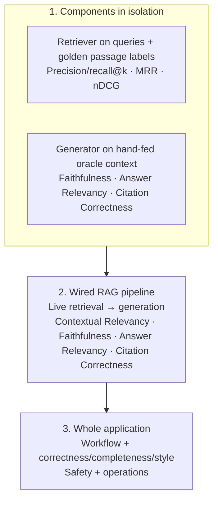

# RAG evaluation strategy

Evaluate three boundaries independently, then run the whole application. Keep component results visible so a strong end-to-end average cannot hide a retriever or generator regression.



## 1. Components in isolation

### Retriever — `rag.retrieve_relevant`

- **Input:** query plus the live pgvector/FTS index.
- **Reference:** human-reviewed relevant source and passage refs in `golden_dataset.json`.
- **Measures:** source and passage precision/recall, hit@k, MRR, nDCG; add Contextual Relevancy as a judge-based signal when useful.
- **Implementation point:** `evals/run_rag_retrieval_eval.py` collects the ranked results; `evals/score_components.py` compares them to gold labels.
- **Benchmark needed:** yes. Retrieval precision/recall/ranking need relevance labels per query. Labels should be reviewed by a person and should include more than one passage when appropriate.
- **Current retrieval changes:** Markdown list items and table rows are chunked as focused passages; JSON catalog entries stay separate; content hashes include the chunker version so indexing refreshes vectors. Explicit review and documentation queries are source-type scoped. Multi-part questions use a lexical coverage pass to select a compact set of relevant passages, with RRF remaining the primary ordering signal.

### Generator — evidence-to-answer with retrieval bypassed

- **Input:** query plus hand-fed reviewed oracle passages; no retriever call.
- **Reference:** no expected answer is supplied to Faithfulness, Answer Relevancy, or Citation Correctness. They are referenceless LLM-judge scores.
- **Measures:** Faithfulness, Answer Relevancy, Citation Correctness; deterministic citation-ID resolution is reported separately.
- **Implementation point:** `evals/run_rag_generator_eval.py --stage generator` supplies fixed oracle passages and records/asserts zero retriever calls.
- **Benchmark needed:** oracle passage/query pairs are needed to make generator results reproducible. Gold answer text is not required for these three scores. Reviewed expected answers are useful as an independent audit, not as judge input for these metrics.

## 2. Wired RAG pipeline

- **Input:** query goes through the real retriever; its ranked passages go to the generator.
- **Measures:** Contextual Relevancy (retrieved context vs query), Faithfulness (answer vs actual retrieved context), Answer Relevancy (answer vs query), and Citation Correctness. Also record exact oracle-passage hit/recall/MRR/nDCG to help attribute failures.
- **Implementation point:** `evals/run_rag_generator_eval.py --stage pipeline` uses the live retrieval wrapper and the same answer generator.
- **Benchmark needed:** yes. Reuse query/passage relevance labels and add human-reviewed oracle passages for generator/pipeline questions. Do not label the output correct solely because a judge likes it.

## 3. Whole application

Score user-visible deliverables after the complete Jev → planner → approval → retrieval/tools → verification → output-guard path:

| Dimension | Current implementation | Grounding |
|---|---|---|
| Workflow completion and agent mechanics | `run_agent_eval.py`: task completion, step efficiency, argument correctness, tool correctness, plan adherence, plan quality, answer correctness | Human-reviewed workflow cases and deterministic trace assertions |
| Answer correctness and completeness | `run_deepeval_specialists.py`: G-Eval against expected findings plus verified evidence; `score_components.py --judge` for the linked answer-quality suite | Human-reviewed expected answers, independently checked numbers, verified evidence |
| Answer style | `Style` G-Eval in `run_deepeval_specialists.py` | A written style rubric; review judge reasons and human ratings before setting pass thresholds |
| Safety and privacy | Jev injection screening, output-guard confusion matrix, `run_toxicity_eval.py`, plus explicit PII cases in the relevant safety suite | Labeled attacks/benign cases and sensitive-output cases; report false blocks and misses separately |
| Operations | Workflow trace wall time, tool/model call counts, failures and duplicate calls | Measured run trace; **token counts and cost are not yet captured in these evaluation artifacts** |

Keep agent-mechanics scores separate from answer quality and safety. Use development cases for iteration; freeze code/prompts before running a separate holdout. Current RAG datasets are small and synthetic, so report case counts and per-case results with every mean.

## Run commands (PowerShell, from `D:\thon`)

These commands use `.eval-venv` for DeepEval and RAG dependencies. The judge and embedding calls use configured Featherless credentials, so they may incur API usage. Predictions and scores have unique names to preserve every run.

```powershell
$tag = Get-Date -Format yyyyMMdd_HHmmss
$genPred = "evals\predictions_rag_generator_$tag.jsonl"
$genScore = "evals\results_rag_generator_$tag.json"
$retPred = "evals\predictions_rag_retriever_$tag.jsonl"
$retScore = "evals\results_rag_retriever_$tag.json"
$pipePred = "evals\predictions_rag_pipeline_$tag.jsonl"
$pipeScore = "evals\results_rag_pipeline_$tag.json"

# 1a. Isolated generator: oracle passages, no retrieval
& .\.eval-venv\Scripts\python.exe -B evals\run_rag_generator_eval.py --stage generator --predictions $genPred --scorecard $genScore

# 1b. Isolated retriever: live index, ranked results vs golden passage labels
& .\.eval-venv\Scripts\python.exe -B evals\run_rag_retrieval_eval.py --top-k 5 --output $retPred
& .\.eval-venv\Scripts\python.exe -B evals\score_components.py --component rag_retrieval --retrieval-top-k 5 --split development --predictions $retPred | Set-Content $retScore

# 2. Wired retrieval plus generation
& .\.eval-venv\Scripts\python.exe -B evals\run_rag_generator_eval.py --stage pipeline --top-k 5 --predictions $pipePred --scorecard $pipeScore

# 3. Whole app — workflow/mechanics, answer quality, style, safety, operations
$appTrace = "evals\predictions_agent_metrics_app_$tag.jsonl"
$appScore = "evals\results_agent_metrics_app_$tag.json"
python -B evals\run_agent_eval.py --trace $appTrace --output $appScore --judge
& .\.eval-venv\Scripts\python.exe -B evals\run_app_style_eval.py --predictions $appTrace --output "evals\results_app_style_$tag.json"
& .\.eval-venv\Scripts\python.exe -B evals\run_live_components.py --component output_guard --split development --output "evals\predictions_output_guard_$tag.jsonl"
& .\.eval-venv\Scripts\python.exe -B evals\score_components.py --component output_guard --split development --predictions "evals\predictions_output_guard_$tag.jsonl" | Tee-Object -FilePath "evals\results_output_guard_$tag.json"
& .\.eval-venv\Scripts\python.exe -B evals\run_toxicity_eval.py --output "evals\results_toxicity_$tag.json" --agent-predictions $appTrace
```

Then review the JSON case rows, not just the means. A low Contextual Relevancy score points to retrieval noise; high Answer Relevancy with low Faithfulness means an on-topic but unsupported answer; a low isolated generator score with a healthy pipeline retrieval score points to generation/citation behavior. The judge metrics have no release threshold until calibrated against human-scored examples.
